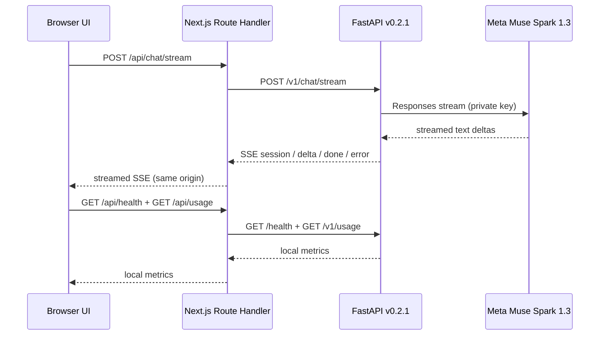

# Phase 2 — Next.js dashboard (v0.3.0)

## Scope and current verification

A new frontend workspace lives in `frontend/`; it calls the existing **FastAPI v0.2.1** through same-origin Next.js Route Handlers. The Meta API key stays **only in the Python `.env`**. The frontend does not import the OpenAI SDK or `jiter`.

**Implemented in code:**

- Responsive application shell with navigation sidebar, keyboard shortcuts (`Ctrl+K` for new chat, `/` to focus search), accessible controls, and dark/light theme.
- Text streaming via `fetch(POST /api/chat/stream)` and SSE parser; the Next route handler proxies to FastAPI `POST /v1/chat/stream` without buffering the full response.
- Conversation list, search, new conversation, delete *local* conversation, export transcript JSON, status messages and copy-assistant-reply button.
- Stop generation (`AbortController`), formatted errors, an offline connection indicator and health polling.
- Usage dashboard showing FastAPI in-memory estimates plus local browser transcript counts. These are **not** account credit or enforcement limits.
- Local browser transcript persistence in `localStorage`, with explicit privacy warnings. UUID conversation pointers only work as long as the **same FastAPI process** remains alive; when the backend loses a session, a 404 message instructs the user to begin a new chat.
- Preferences overlay: theme toggle and local-chat removal; future voice and memory features explicitly marked unavailable.
- Layout responsive to desktop/tablet/mobile, screen-reader labels, keyboard navigation, reduced-motion fallback.

**Not yet implemented:** voice; image upload; arbitrary model choice; actual durable memory; server user identities; multi-device sync; production auth, hard spending limit; browser/tools; Meta-hosted conversation deletion. This release must not be internet-facing.

## Data flow



## Running on Windows 11 / PowerShell

Requirements: Python 3.11+, Node.js **20.9+** (prefer supported Node LTS), npm, VS Code. Two PowerShell terminals are necessary.

**Terminal A — backend, from the `muse-nova` project root:**

```powershell
py -m venv .venv
.\.venv\Scripts\Activate.ps1
python -m pip install -r requirements.txt
# Copy your existing private .env into this folder, or create one from .env.example
uvicorn app.main:app --reload --host 127.0.0.1 --port 8000
```

**Terminal B — dashboard:**

```powershell
cd frontend
Copy-Item .env.local.example .env.local
npm install
npm run typecheck
npm run test:stream
npm run dev
```

Browse **http://127.0.0.1:3000**. The old no-build HTML demo remains on port **8000**, but port 3000 is the Phase 2 UI.

**Testing:**

```powershell
# From frontend/
npm run build
npm run lint
npm run test:stream
# From project root, in the Python venv:
python -m pytest -q
```

## Privacy and deployment boundaries

- The frontend proxy **does not authenticate users**, but only listens on `127.0.0.1` during local development. Never change the host to `0.0.0.0` for this release.
- `MUSE_BACKEND_URL` is server-only and validated to a loopback HTTP host; never put `MODEL_API_KEY` in `frontend/.env.local` or use `NEXT_PUBLIC_MODEL_API_KEY`.
- Conversation text is held in **browser localStorage without encryption**; do not submit private data. Delete/local-clear removes browser copies **only**, not Meta's stored Responses or server RAM.
- Meta Responses `store:true` and `previous_response_id` remain active. This API is **not** a user-controlled privacy retention implementation.
- Stopping a request or closing a tab does **not** guarantee that the upstream request stops billing or processing. Partial text may appear before a failed stream; it is marked as failed.
- The backend process keeps in-memory response pointers, so old browser threads may fail after a restart. A future persisted conversation layer must resolve this.
- No actual hard cost cap; inspect Meta dashboard balances and protect credits with provider controls where available.

## Next acceptance checks (run on developer PC)

- [ ] `npm install` succeeds, and `npm run typecheck` / `npm run build` complete.
- [ ] Port 3000 loads desktop and mobile layouts.
- [ ] `Connected` appears when the port 8000 backend is running.
- [ ] Streaming response renders in the transcript.
- [ ] A second message in the same thread remembers context.
- [ ] New chat starts a new session; switching between live threads works.
- [ ] Sidebar search, export, local-delete, themes, and keyboard shortcuts work.
- [ ] Stop action interrupts display and shows the credit warning.
- [ ] Usage panel matches approximate `/v1/usage` data (no Meta balance claimed).
- [ ] Backend restart results in a clean unknown-conversation message (not silent reattachment).

## Why server-side Next.js proxy?

It avoids CORS development configuration, provides a stable same-origin API contract, allows future session auth and rate-limit controls, and isolates backend internals from browser JavaScript. It is **not** a substitute for real production authentication or authorization.
