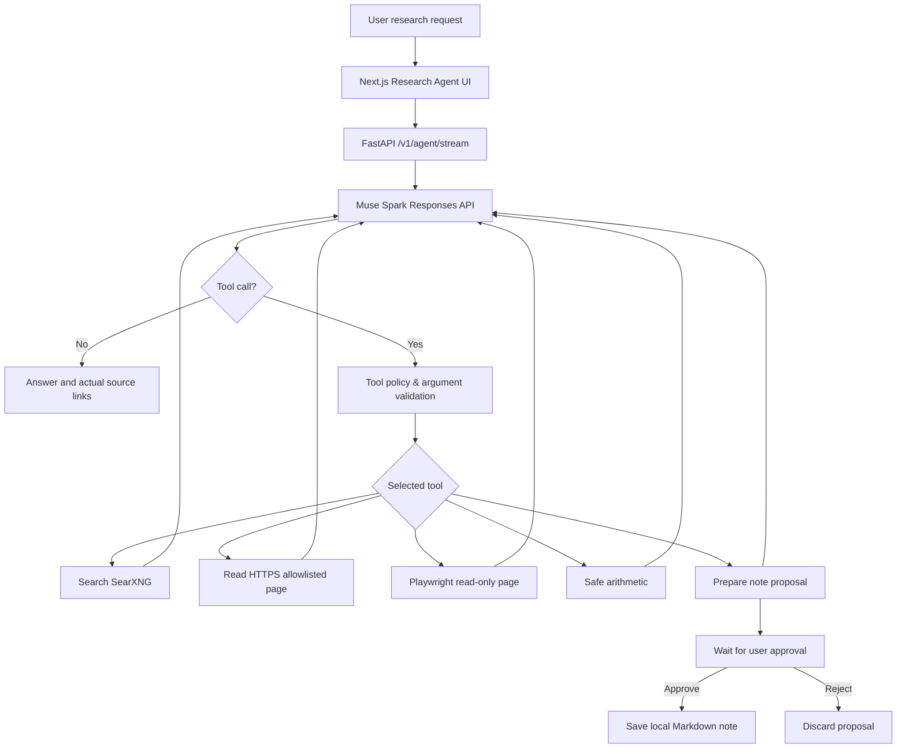

# Phase 5 — Research and approval-controlled tools (v0.8.0)

## Release scope

MUSE Nova Phase 5 is a **local-only research agent MVP**. It is not an unrestricted autonomous system. The existing Phase 1–4 text/voice/image/document/screen UI is preserved; open the new **Research Agent** screen at `http://127.0.0.1:3000/agents`.

The agent uses the **Meta Muse Spark Responses API function-calling contract**: flat JSON-schema tools, `output` items with `type=function_call`, and follow-up `input` entries containing `type=function_call_output` with the original `call_id` plus `previous_response_id`. This intentionally uses HTTPX (not the Windows-blocked OpenAI SDK `jiter`).

## Workflow



## What actually works in source

- `search_web(query)`: optional **local SearXNG** JSON API, returns maximum five HTTPS results on approved domains. Requires Docker Desktop or an existing instance, explicit `.env` configuration, internet access, and JSON format enabled. Not functional out of the box without SearXNG.
- `read_page(url)`: fetch HTTPS HTML/plain text, size capped at 120 KB, text capped at 7,000 chars. Host must be on explicit `AGENT_ALLOWED_DOMAINS` list and publicly resolvable. No redirects; no credentials; remote content is untrusted.
- `browser_page(url)`: optional Playwright Chromium read-only DOM view. Scripts, subresources, downloads and forms are disabled; may not render heavily client-side websites. Install Playwright chromium separately (`python -m playwright install chromium`). No clicking, posting, logging in or filing forms.
- `calculate(expression)`: AST whitelist arithmetic, no `eval`, imports or arbitrary code execution.
- `propose_note(title,content)`: only stages an in-memory approval token (1h expiry), max 20 outstanding proposals. **Nothing is saved until** `POST /v1/agent/actions/{action_id}/approve` receives explicit `{"approve":true}` from user. Approved notes use UUID filenames in `data/agent_notes/` only. Rejection deletes the token. Approvals cannot be used twice.
- Up to five model planning rounds and ten tool calls per request. Status/tool/source/approval/done/error events stream to the Next UI. Tool loop may consume more Meta tokens than normal chat. Costs are not currently integrated with `/v1/usage`; actual billing remains in Meta dashboard.

## Setup on Windows (PowerShell)

1. Extract the v0.8.0 ZIP as a new folder. Copy your private `.env` and existing Kokoro model assets from the working v0.7.2 folder. Never include keys in a ZIP or git.
2. Configure `.env` (add these lines if your copied file lacks them):

```dotenv
SEARXNG_BASE_URL=http://127.0.0.1:8080
AGENT_ALLOWED_DOMAINS=wikipedia.org,arxiv.org,github.com,docs.python.org,developer.mozilla.org,docs.searxng.org
MAX_OUTPUT_TOKENS=4096
MUSE_REASONING_EFFORT=minimal
```

3. Start SearXNG with Docker Desktop running:

```powershell
cd infra\searxng
docker compose up -d
cd ..\..
Invoke-RestMethod 'http://127.0.0.1:8080/search?q=python&format=json'
```

If JSON returns `403`, check the mounted `settings.yml`, then `docker compose restart`. Search may also fail when external search engines rate-limit the SearXNG container.

4. In the project root, install requirements and optionally the browser:

```powershell
py -m venv .venv
.\.venv\Scripts\Activate.ps1
python -m pip install -r requirements-agent.txt
python -m playwright install chromium   # optional for browser_page
python -m pytest -q
python -m uvicorn app.main:app --reload --host 127.0.0.1 --port 8000
```

5. Second terminal:

```powershell
cd frontend
Copy-Item .env.local.example .env.local
npm install
npm run test:stream
npm run typecheck
npm run build
npm run dev
```

Open `http://127.0.0.1:3000/agents`. Run `powershell -ExecutionPolicy Bypass -File .\scripts\test-phase5.ps1` from the root for free local readiness. Use `-Live` for one **billable** Muse tool-loop call. Test note approval and rejection from the UI, then inspect `data/agent_notes/`.

## API endpoints

| Method | Endpoint | Purpose |
|---|---|---|
| GET | `/v1/agent/status` | Check search setup, approved domains and limits (no charge) |
| POST | `/v1/agent/stream` | Body `{"prompt":"..."}`; SSE `start`, `status`, `tool`, `approval`, `done`, `error` |
| POST | `/v1/agent/actions/{uuid}/approve` | Body `{"approve":true/false}`; one-time note save or rejection |

Next.js exposes corresponding same-origin `/api/agent/...` routes; Meta key remains server-side.

## Safety limits and remaining work

- Phase 5 **does not** send email, execute shell commands, run arbitrary Python, log into sites, or click browser controls. Integrations with OAuth-scoped Gmail/calendar/files are **not shipped**.
- This is an **unauthenticated single-user localhost prototype**. It has no authenticated approval identity, no CSRF token, no per-user isolation, no persistent execution state, no encrypted storage, no hard Meta cost cap. **Never expose ports 3000 or 8000 to the internet.**
- Explicit domain allowlisting, refusal of non-public DNS, no redirects and read-only browsing reduce SSRF risk; they are **not a complete defense** against DNS rebinding or malicious remote content. For production, use an isolated egress proxy/network-level IP restrictions and pinned DNS connections; Playwright needs an OS/container sandbox.
- SearXNG snippets and remote pages may attempt prompt injection; treat those as untrusted evidence, not commands. Answer quality and links still require human review.
- Approval state and active jobs are RAM-only, lost on process restart. Notes are saved locally and are not indexed into long-term memory.
- Live Meta tool-calling, real Docker search, Playwright on Windows, UI approval flow, and full Next.js build **still require user verification**. Offline mocks do not establish live integration.

## Next phases

- **Phase 6:** PostgreSQL/pgvector long-term memory, citation-aware retrieval, LangGraph task checkpointing and memory deletion controls.
- **Phase 7:** Muse Glimmer on AMD MI300X, hardware-aware model routing and reproducible benchmarks.
- **Phase 8:** user authentication, secure OAuth integrations, hard spend caps, observability and deployment.
- **Phase 9:** broader personal AgentOS once production-grade permissions exist.

## References

- Meta Responses tool calling: https://dev.meta.ai/docs/tool-calling
- Meta Responses multi-turn: https://dev.meta.ai/docs/protocols/responses
- SearXNG JSON search API: https://docs.searxng.org/dev/search_api.html
