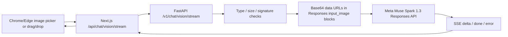

# Phase 4.1 — Image Understanding (v0.6.0)

**Release intent:** extend the existing v0.5.1 application without changing working text and realtime voice paths. Local Windows/PowerShell first. No user data or `.env` keys included in release archives.

## Product scope

- Attach **1–3** JPEG, PNG or WebP images to a new chat message (each **≤ 4 MiB**). Select, paste, or drag images; preview before sending and remove selected items.
- Ask a question or submit images without text (application supplies a descriptive default prompt).
- See the image filenames in the local transcript, stream the model's answer through the existing SSE client, and ask follow-up questions without reattaching the image, as long as the Meta-managed response chain remains available.
- Retain Phase 1 text chat, Phase 2 dashboard, and Phase 3.1/3.2 voice interaction. In Phase 4.1, image attachments are initiated in the text composer; continuous voice turns are text-only, but can follow an earlier image turn in the same conversation.
- No PDF, Word, OCR indexing, local file retrieval, active screen monitoring, or computer-use agent yet. These belong to later phases.

## Data flow



## Request contract

Send a multipart form (`message`, optional `conversation_id`, repeated `images`) to either of:
- `POST /api/chat/vision/stream` on Next.js (`:3000`, user interface same-origin proxy).
- `POST /v1/chat/vision/stream` on FastAPI (`:8000`, local backend direct test).

Backend validates allowed media types, byte-size bounds, first-byte signatures, and number of files, then constructs:

```json
{
  "model": "muse-spark-1.3",
  "input": [
    {"type": "message", "role": "user", "content": [
      {"type": "input_text", "text": "Summarize the diagram"},
      {"type": "input_image", "image_url": "data:image/png;base64,..."}
    ]}
  ],
  "previous_response_id": "resp_... only when continuing a conversation"
}
```

`image_url` is a **plain string** for the Responses API, not the `{url: ...}` object used by Chat Completions. The existing provider's model name, instructions, low reasoning effort, model token budget, and `store:true` remain unchanged.

SSE format is unchanged: `session`, zero or more `delta`, terminal `done` (including full answer, usage, IDs), or `error`. Conversation response ID is updated **only after** a successful `done` event. Image bytes are not copied into local chat history; only filenames appear in the UI.

## Security and limitations

1. **Local-only and unauthenticated**. Do not deploy this as a publicly accessible service until authentication, CSRF prevention, reverse-proxy body-size restrictions and session ownership are implemented.
2. Images are transferred from the user's browser through Next.js/FastAPI to Meta for processing. The project does **not deliberately save or log image bodies**, but multipart parsing can temporarily spool uploads to OS temporary storage; Meta's provider-side policies apply. Browser local storage keeps only image **filenames**, text and session IDs. UI preview object URLs are revoked when deselected.
3. Neither the frontend nor screenshots can access `MODEL_API_KEY`; only Python FastAPI reads its `.env`.
4. Supported types are JPEG/PNG/WebP. The backend checks signatures but does **not fully decode or virus-scan** images. SVG, PDFs, HEIC, animation-specific processing and arbitrary files are rejected.
5. Each image costs input tokens, often more at high resolution. Usage estimates use Meta's returned token counts; they are not a wallet balance or quota enforcement. Track the $150 credit balance in Meta's dashboard. Avoid confidential screenshots.
6. Meta-managed conversation history is not deleted when local browser history is cleared. No long-term memory or local image archive in this phase. Backend restarts invalidate its in-memory conversation IDs.

## Verification on Windows

Start FastAPI and Next.js using the existing README commands. Check endpoints:

```powershell
powershell -ExecutionPolicy Bypass -File .\scripts\test-vision.ps1
# Make one real, paid vision call (choose a nonsensitive image):
powershell -ExecutionPolicy Bypass -File .\scripts\test-vision.ps1 -Live -ImagePath "C:\path\to\chart.png"
# After starting frontend, test Next.js proxy:
powershell -ExecutionPolicy Bypass -File .\scripts\test-vision.ps1 -Live -ViaFrontend -ImagePath "C:\path\to\chart.png"
```

Manual browser acceptance: attach an image, preview and remove/reselect it; send with text; verify streaming and full answer; ask "What did the image show?" without attaching again; verify push-to-talk and live voice still operate. Check rejection of invalid and >4 MiB files and confirm no raw image bytes in exported local JSON.

**Offline checks:** `python -m pytest -q` (mock providers, no Meta calls), `cd frontend; npm run test:stream` (13 tests) and full `npm run typecheck; npm run build` after `npm install` on Windows.

## Verified upstream reference
- Meta Image Understanding: https://dev.meta.ai/docs/image-understanding
- Meta Responses API: https://dev.meta.ai/docs/protocols/responses

## Future increments
- **Phase 4.2:** PDF/document files, optional extraction and page citations; validate multimodal file handling and privacy boundaries.
- **Phase 4.3:** user-authorized screenshot capture and voice-assisted visual interpretation; no passive surveillance.
