# Phase 3.1 — Push-to-talk speech beta (v0.4.0)

**Status:** Source implemented, offline-tested. User must run browser / live Meta ASR / Kokoro smoke tests before calling it verified.

## Architecture

```mermaid
flowchart LR
 B[Browser microphone] --> R[MediaRecorder one utterance]
 R --> WAV[WebAudio decode/downmix/resample → 24 kHz PCM16 WAV]
 WAV --> NX[Next.js /api/voice/transcribe]
 NX --> FA[FastAPI /v1/voice/transcribe]
 FA --> META[Muse Voice Transcribe HTTP multipart]
 META --> TEXT[Transcript]
 TEXT --> CHAT[Existing /api/chat/stream SSE]
 CHAT --> MUSE[Muse Spark 1.3]
 MUSE --> UI[Chat text/history]
 UI --> SP[Click Listen / optional Auto Speak]
 SP --> NX2[Next.js /api/voice/synthesize]
 NX2 --> TTS[FastAPI Kokoro-ONNX]
 TTS --> PLAY[Browser HTMLAudioElement]
```

This is **turn-based push-to-talk**, not full real-time streaming ASR. Only the LLM text path streams in Phase 3.1. True WebSocket microphone streaming and low-latency chunked TTS are deferred to Phase 3.2.

## Contract

| Method | Route | Input | Output |
|---|---|---|---|
| POST | `/v1/voice/transcribe` | `multipart/form-data`, `audio` mono PCM16 WAV (16 or 24 kHz), <=5 MiB/90 sec | JSON `{transcript,duration_seconds,model}` |
| POST | `/v1/voice/synthesize` | `{text: string (1..600), voice?: one of 4 voices}` | `audio/wav` |
| POST | Next `/api/voice/transcribe` | Same recording | Same JSON |
| POST | Next `/api/voice/synthesize` | Same text/voice | WAV bytes |

The browser never receives the Meta API credential. Meta ASR is authenticated in FastAPI via `MODEL_API_KEY`, using the official HTTP multipart file endpoint. Data uploaded to the hosted model is subject to Meta's terms; the backend does not retain submitted audio. The browser saves transcribed text in its existing local chat transcript.

## Windows 11 installation

1. Extract v0.4.0 into a **new directory**, copy your previously working `.env` to its project root (not `frontend/`).
2. Python venv, `python -m pip install -r requirements-voice.txt`. **Python 3.10–3.13** supported by the current `kokoro-onnx` PyPI package (verify your `python --version`). If native ONNX modules are blocked by your organization's Application Control, contact your administrator; do not disable security controls. You can still test Meta ASR without Kokoro TTS.
3. `powershell -ExecutionPolicy Bypass -File .\scripts\setup-kokoro.ps1` downloads official ONNX + voice files (~354MB). It prints checksums for reproducibility. Files stay under `models/kokoro/` and are ignored by Git.
4. `uvicorn app.main:app --reload --host 127.0.0.1 --port 8000`.
5. In another terminal, `cd frontend; npm install; npm run typecheck; npm run build; npm run test:stream; npm run dev`.
6. Open `http://127.0.0.1:3000`. Click the microphone, permit recording, speak for ~3–6 sec, then click Stop mic. Inspect transcript and streamed reply.
7. Click **Listen** under the reply to synthesize speech; optionally enable **Automatically speak replies** in Settings. If playback is blocked by browser autoplay, use the direct Listen button.
8. From project root: `powershell -ExecutionPolicy Bypass -File .\scripts\voice-tts-smoke.ps1` (free, local TTS only) and `python -m pytest -q`.

## Voice cost and limits

- ASR billed by Meta for recorded audio; provider's published rate is **$0.18/audio hour**, subject to current pricing, account credits, and API access.
- The voice adapter does not meter live ASR usage in `/v1/usage`; the current dashboard continues to estimate Muse Spark text-token costs only. Check Meta dashboard for actual credit balance.
- Kokoro synthesis is local and does not consume Meta credits, but requires local CPU/RAM.
- Synthesis uses the **first 600 characters** of a selected reply. It is WAV-buffered output, not streamable audio chunks.
- Recordings are limited by the UI timer to 60 sec and server to 90 sec/5 MiB. Text/UI already bounded at 4k characters.
- Never expose localhost development ports to public networks; no production authentication, CSRF, retention, quota, or encryption controls are implemented.

## Phase 3.2 backlog (not implemented)

- Browser AudioWorklet input → short PCM16 frames → authenticated FastAPI WebSocket relay → Muse `wss://api.meta.ai/v1/asr/realtime`. The Meta WebSocket key must go in the *handshake JSON frame*, never browser code; no Authorization HTTP header at that endpoint.
- Meta `ENDPOINTING` with turn IDs; distinguish `speechEnd` from `speechComplete`; replace cumulative partial transcripts rather than appending.
- TTS chunk scheduling to start playback before full completion; audio queue and clean cancellation on barge-in.
- Echo cancellation, VAD status, reconnection, interruption metrics, audio/TTS latency benchmarks.
- Explicit user opt-in to microphone and replay, and protections against accidental tool execution from overheard speech.

## After Phase 3

| Phase | Planned capability | Exit criteria |
|---|---|---|
| 4 Vision & documents | Muse image input, screenshot/PDF uploads, safe limits | Ask about images in same chat; document citations and MIME validation |
| 5 Web and tool execution | Search, Playwright, tool gateway, approval controls | Research with citations; no unapproved external actions |
| 6 Memory and workflows | PostgreSQL/pgvector, consented memory, LangGraph checkpoints | Reliable cross-session recall + review/delete controls |
| 7 Edge and AMD deployment | Muse Glimmer adapter, remote MI300X inference, router | Reproducible local/remote benchmark with actual metrics |
| 8 Production | Authentication, audits, permissions, quotas, monitoring, Docker | Secure deployment gates + cost governance |
| 9 Advanced AgentOS | Specialized collaborating agents, personal productivity orchestration | Evaluated multi-step workflows with explicit authorization |
